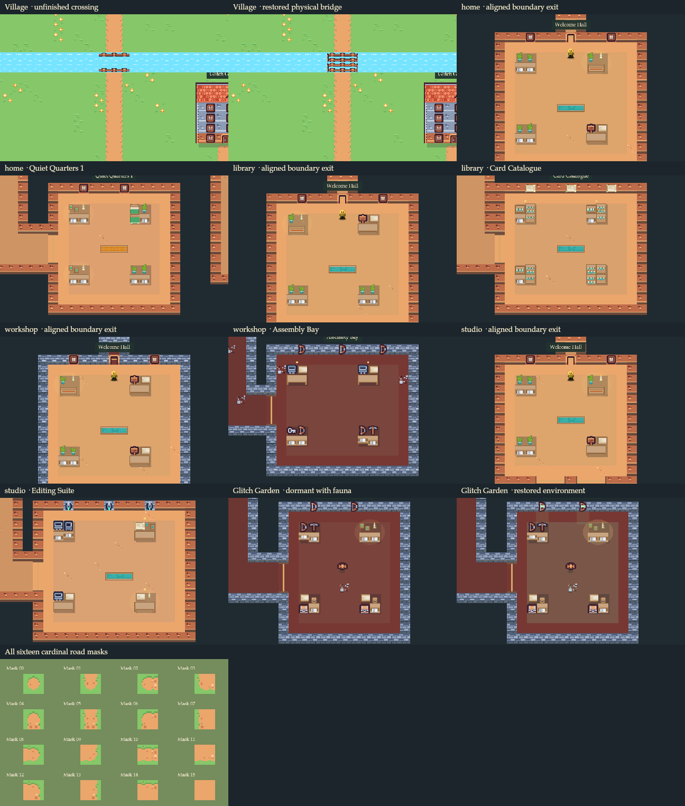

# Offline renderer checks

These images execute the actual V4 canvas renderer with the shipped licensed assets under Node canvas. They show boundary doors, purposeful interiors, the physical canal crossing, restored environmental feedback, fauna, and all sixteen cardinal road masks. They do not demonstrate browser layout, pointer behavior, or deployment.

